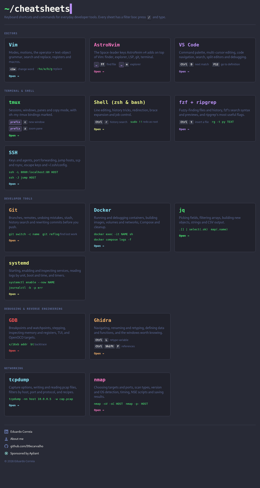
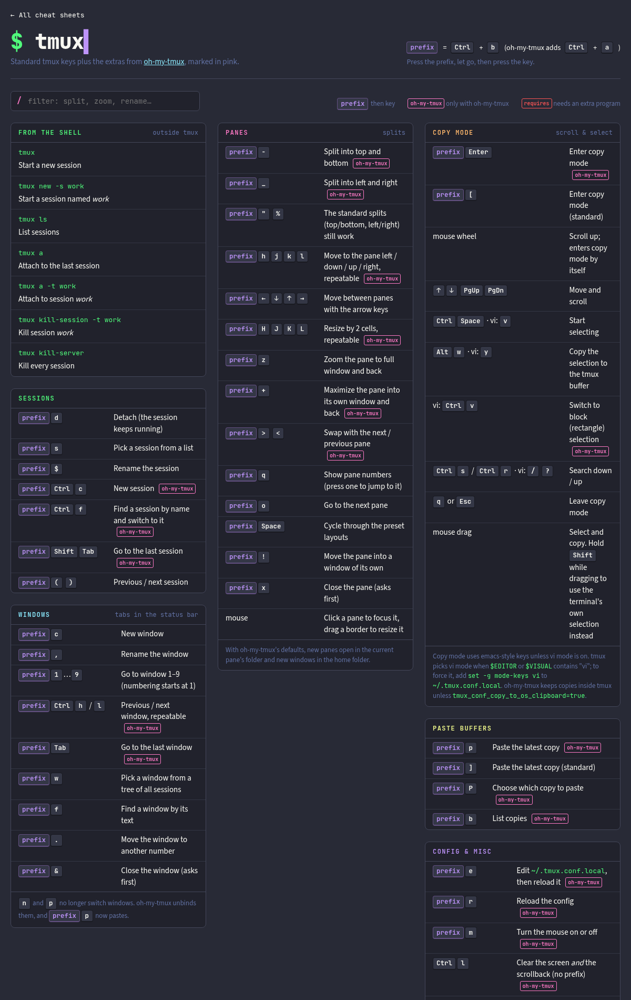

# Cheat Sheets

Keyboard shortcuts and commands for developer tools, as small static web pages.
Each sheet has a filter box. Press `/` and type to find a key.

Browse them at <https://99ecarvalho.github.io/cheatsheets/>.



## Sheets

| Category | Sheets |
|---|---|
| Editors | Vim, AstroNvim, VS Code |
| Terminal & shell | tmux (with oh-my-tmux), zsh & bash, fzf + ripgrep, SSH |
| Developer tools | Git, Docker, jq, systemd |
| Debugging & reverse engineering | GDB, Ghidra |
| Networking | tcpdump, nmap |



## Build

You need Python 3.8 or newer. There are no other dependencies.

```sh
python3 build.py
```

This writes the pages to `site/`. Open `site/index.html` in a browser.
Use `-o DIR` to write somewhere else.

Every push to `main` builds the site and publishes it to GitHub Pages
(see `.github/workflows/pages.yml`).

The pages work offline. Online, they load two fonts from Google Fonts.
Light and dark mode follow your system setting.

## Add or edit a sheet

Sheets are plain text files in `src/`. One file makes one page.
The index groups the pages by their `category`.

```text
title: Git Commands
name: git
sub: The commands you look up most.
category: Developer tools
color: orange
blurb: Branches, remotes and undoing mistakes.

## Undo ¦ fix mistakes ¦ red
`git restore FILE` ¦ Throw away unstaged changes to a file
⟨Ctrl⟩⟨r⟩ ¦ Search history
> A note under the table.
```

- `## Title ¦ note ¦ colour` starts a section.
- `keys ¦ description` adds a row. The separator is `¦`, not `|`.
- `⟨Ctrl⟩` is a key, `⟪prefix⟫` is a highlighted key and `` `code` `` is code.
- Anything else is HTML.

The top of `build.py` lists every field. Run the build again after a change.

## Layout

```text
src/       sheet sources (.txt)
assets/    stylesheet, filter script and images, copied into site/
build.py   the generator
site/      generated output (not tracked by git)
doc/       screenshots for this README
```

## Contributing

Corrections and new sheets are welcome. Open an issue or a pull request.
Test keys in the program before you add them.
Keep descriptions short, and write them for any reader, not for one machine.

## License

Copyright (C) 2026 Eduardo Correia.

This project is free software under the GNU General Public License,
version 3 or later. See [COPYING](COPYING).

The Apliant logo in `assets/img/` belongs to Apliant. The GitHub and LinkedIn
icons are trademarks of their owners. The GPL does not cover them.

## Credits

Made by [Eduardo Correia](https://www.linkedin.com/in/c99-eduardo/)
([about](https://www.apliant.com.br/eduardo/)).
Sponsored by [Apliant](https://www.apliant.com.br).
The colours come from [Dracula](https://draculatheme.com).
